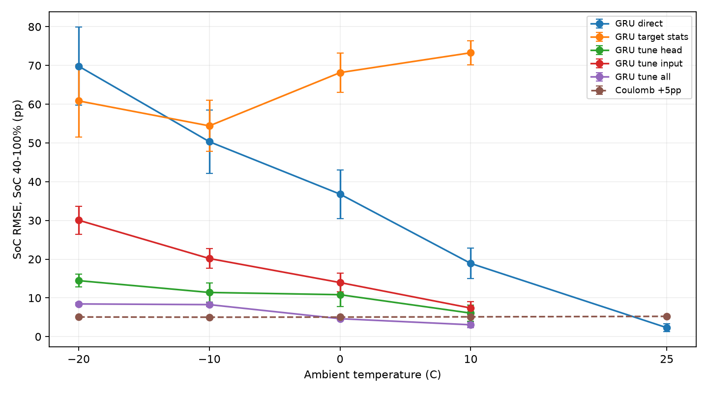
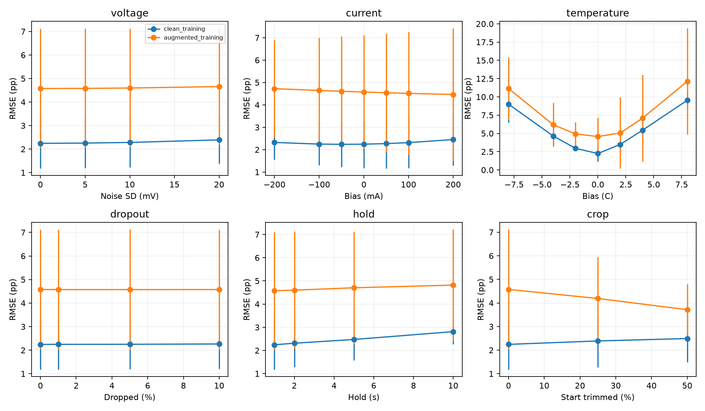
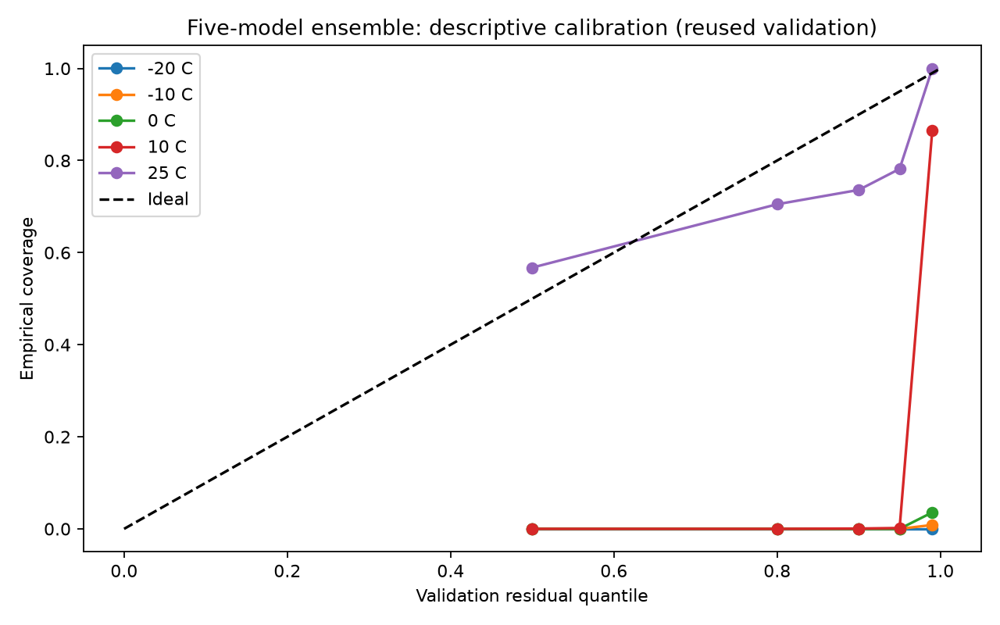
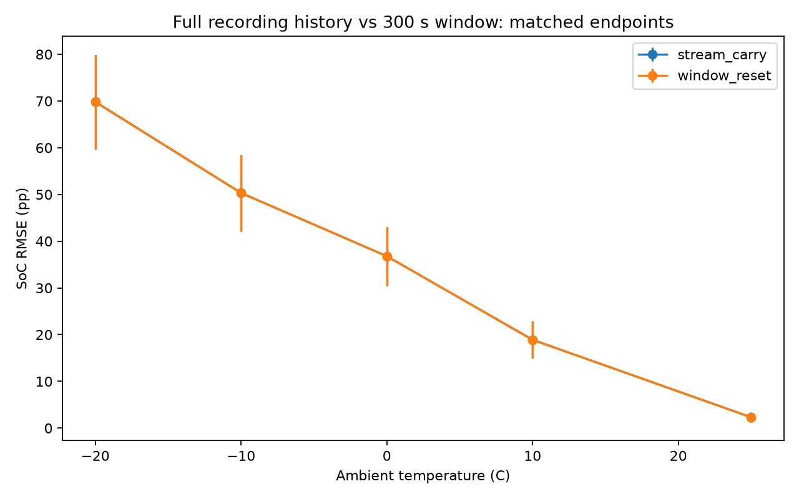

# Experiment results (E1–E9, streaming)

Configurations and commands are described in the top-level README. Source models scale temperature with the fixed rule (T − 25) / 20 and standardize voltage and current on the 25°C training data. E3/E7 fine-tuning runs exactly 300 Adam steps (10 s window stride, batch 32, learning rate 1e-3); E9 runs 100 steps per update, 300 in total. Both settings were revised after an initial run (see ../fix-check-v1); results under the earlier settings remain in ../modular-v2.

## Temperature transfer and adaptation (E1/E2/E3)

SoC 40–100%, RMSE in percentage points; mean ± sample SD over three seeds. Adaptation uses only the first 1,800 s of each target-temperature Cycle 1 and never touches test data. Target statistics re-estimate the voltage and current mean and SD only; temperature keeps the fixed rule.

| Method | 25°C | 10°C | 0°C | -10°C | -20°C |
| --- | --- | --- | --- | --- | --- |
| Direct transfer | 2.31 ± 1.05 | 18.90 ± 3.93 | 36.78 ± 6.29 | 50.32 ± 8.23 | 69.81 ± 10.11 |
| Target statistics (V, I) | — | 73.28 ± 3.08 | 68.16 ± 5.08 | 54.41 ± 6.57 | 60.85 ± 9.36 |
| Output layer, 300 steps | — | 6.07 ± 2.13 | 10.82 ± 3.01 | 11.40 ± 2.44 | 14.46 ± 1.62 |
| Input layer, 300 steps | — | 7.37 ± 1.64 | 13.96 ± 2.41 | 20.16 ± 2.54 | 30.05 ± 3.63 |
| All parameters, 300 steps | — | 3.06 ± 0.71 | 4.63 ± 0.27 | 8.26 ± 0.47 | 8.44 ± 0.37 |
| Coulomb counting (+5 pp initial error) | 5.23 ± 0.00 | 5.11 ± 0.00 | 5.04 ± 0.00 | 5.01 ± 0.00 | 5.07 ± 0.00 |

## Dynamic int8 (E6)

| Method | 25°C | 10°C | 0°C | -10°C | -20°C |
| --- | --- | --- | --- | --- | --- |
| float32 | 2.31 ± 1.05 | 18.90 ± 3.93 | 36.78 ± 6.29 | 50.32 ± 8.23 | 69.81 ± 10.11 |
| Dynamic int8 | 2.34 ± 0.99 | 18.83 ± 3.88 | 36.61 ± 6.32 | 50.05 ± 8.07 | 69.45 ± 9.88 |

3,597 parameters; float32 file 17,549 bytes, dynamic int8 9,097 bytes. File size is not MCU Flash/RAM usage.

## LG cross-cell transfer (E7)

Panasonic source models applied to LG HG2; adaptation uses the first 1,800 s of each temperature's Mixed1 recording with the E3 settings.

| Method | 25°C | 10°C | 0°C | -10°C | -20°C |
| --- | --- | --- | --- | --- | --- |
| Direct transfer | 4.02 ± 0.78 | 19.03 ± 4.30 | 35.11 ± 6.81 | 53.70 ± 9.19 | 76.25 ± 11.05 |
| Target statistics (V, I) | 78.28 ± 0.81 | 84.59 ± 4.07 | 84.96 ± 6.61 | 84.12 ± 9.00 | 86.23 ± 11.05 |
| Output layer, 300 steps | 4.02 ± 0.15 | 6.99 ± 2.13 | 9.84 ± 2.57 | 8.50 ± 2.48 | 17.69 ± 2.86 |
| Input layer, 300 steps | 3.41 ± 0.41 | 7.61 ± 1.60 | 12.61 ± 2.98 | 21.85 ± 4.06 | 31.54 ± 3.50 |
| All parameters, 300 steps | 7.09 ± 1.02 | 6.51 ± 0.77 | 5.63 ± 0.38 | 6.12 ± 0.25 | 11.15 ± 0.78 |

## Online updates and forgetting (E9)

Target Cycle 1 is split chronologically into three 600 s chunks with 100 steps per update; errors before and after the three updates (mean over three seeds).

| Target / supervision | Target before → after | 25°C source before → after |
| --- | --- | --- |
| 10°C / true_label | 18.90 → 4.53 | 2.31 → 15.13 |
| 10°C / coulomb_pseudo | 18.90 → 4.52 | 2.31 → 15.13 |
| 0°C / true_label | 36.78 → 7.60 | 2.31 → 18.84 |
| 0°C / coulomb_pseudo | 36.78 → 7.62 | 2.31 → 18.88 |
| -10°C / true_label | 50.32 → 12.77 | 2.31 → 14.62 |
| -10°C / coulomb_pseudo | 50.32 → 12.78 | 2.31 → 14.62 |
| -20°C / true_label | 69.81 → 14.17 | 2.31 → 16.34 |
| -20°C / coulomb_pseudo | 69.81 → 14.16 | 2.31 → 16.33 |

## Signed input bias (E4)

25°C, SoC 40–100%, RMSE in percentage points; mean ± sample SD over three seeds.

| Input bias | Clean training | Augmented training |
| --- | --- | --- |
| Current -200 mA | 2.322 ± 0.774 | 4.725 ± 2.175 |
| Current +200 mA | 2.451 ± 1.166 | 4.464 ± 2.956 |
| Temperature -8°C | 9.005 ± 2.529 | 11.156 ± 4.285 |
| Temperature +8°C | 9.536 ± 1.120 | 12.127 ± 7.254 |

The augmentation recipe stays at 5 mV, +50 mA and +2°C; negative offsets are an added control. Positive-direction augmentation does not guarantee robustness to the opposite direction; unfavourable results are kept.

## Five-model uncertainty (E8)

Seeds 17, 42, 2026, 101 and 314. This is one five-model ensemble; validation data are reused for early stopping, so only empirical coverage is reported, with no independent calibration guarantee.

| Ambient | Raw interval coverage | Validation-residual coverage | Residual interval width (pp) |
| --- | --- | --- | --- |
| 25°C | 91.9% | 97.8% | 6.952 |
| 10°C | 21.1% | 0.0% | 6.952 |
| 0°C | 0.7% | 0.0% | 6.952 |
| -10°C | 0.0% | 0.0% | 6.952 |
| -20°C | 0.0% | 0.0% | 6.952 |

## Full-recording streaming

Compared at matched window endpoints, SoC 40–100%. State is carried within a file and reset between files; it is not reset between execution chunks.

| Ambient | Reset-window RMSE | Streaming RMSE | Max pointwise difference (pp) |
| --- | --- | --- | --- |
| 25°C | 2.305 ± 1.054 | 2.305 ± 1.054 | 1.19209e-05 |
| 10°C | 18.895 ± 3.925 | 18.895 ± 3.925 | 1.78814e-05 |
| 0°C | 36.784 ± 6.289 | 36.784 ± 6.289 | 1.19209e-05 |
| -10°C | 50.319 ± 8.232 | 50.319 ± 8.232 | 1.19209e-05 |
| -20°C | 69.815 ± 10.111 | 69.815 ± 10.111 | 1.19209e-05 |

577,041 test samples over three seeds and 15 independent test files. This compares state history on the same offline-resampled data; it is neither an MCU real-time measurement nor a test of online sensor interpolation.

## Verification evidence

verification.json records the configurations, ensemble size, temperature rule and adaptation step budgets, signed-bias ranges and streaming endpoint alignment. It also holds two numerical regression checks: E5, which does not depend on the source models, against the earlier run; and direct transfer plus 300-step tuning against the diagnostic check's variant B, seed by seed (tolerance 1e-4). pipeline.json records the command of every independent stage; each stage folder holds its configuration and a COMPLETE marker.
